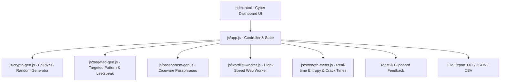

# Password & Wordlist Generator Suite Implementation Plan

> **For agentic workers:** REQUIRED SUB-SKILL: Use superpowers:subagent-driven-development to implement this plan task-by-task. Steps use checkbox (`- [ ]`) syntax for tracking.

**Goal:** Transform the repository into a modern, high-performance, cybersecurity-oriented password and wordlist generator suite with 4 generation modes, Web Crypto API security, Web Worker concurrency, real-time entropy analysis, and a sleek cyber dashboard UI.

**Architecture:** A 100% client-side, zero-build-step vanilla ES6+ web application. Core functionality is divided into focused modules (`crypto-gen.js`, `targeted-gen.js`, `passphrase-gen.js`, `strength-meter.js`, `wordlist-worker.js`), coordinated by `app.js` and rendered inside `index.html` styled with a modern glassmorphic cybersecurity design system.

**Architecture Diagram:**

**Tech Stack:** HTML5, CSS3 (Custom properties, Flexbox/Grid, Glassmorphism), Modern JavaScript (ES6+, Web Crypto API, Web Workers, Blob APIs), FontAwesome 6 (CDN).

**Spec:** `docs/superpowers/specs/2026-11-02-password-generator-overhaul-design.md`

## Global Constraints

- Pure client-side application: zero npm dependencies, zero build steps, runs directly in browser and GitHub Pages.
- Cryptographic operations in random mode MUST use `window.crypto.getRandomValues()`.
- Heavy wordlist generation MUST NOT block the main UI thread (use Web Worker).
- UTF-8 clean encoding for all files (no UTF-16LE).
- Mobile-responsive down to 360px viewport width.

---

### Task 1: Design System & Styling Architecture

**Files:**
- Create: `css/styles.css`
- Create: `css/components.css`
- Create: `css/cyber-theme.css`
- Create: `assets/favicon.svg`

**Interfaces:**
- Produces: CSS custom properties (`--bg-main`, `--bg-card`, `--accent-cyan`, `--accent-green`, `--accent-purple`, `--text-main`, `--text-muted`), component classes (`.btn`, `.tab-btn`, `.card`, `.badge`, `.slider`, `.switch`, `.toast`, `.metric-box`).

- [ ] **Step 1: Create favicon SVG**
  Create `assets/favicon.svg` featuring a modern cyber shield / lock icon.
- [ ] **Step 2: Create `css/styles.css`**
  Define reset, CSS variables, typography, responsive container, header, navbar, and grid layouts.
- [ ] **Step 3: Create `css/components.css`**
  Style tab buttons, input groups, range sliders, toggle switches, buttons, modals, output terminals, and toast container.
- [ ] **Step 4: Create `css/cyber-theme.css`**
  Implement glassmorphism, neon glows, animated gradient borders, custom dark scrollbars, and keyframe animations.
- [ ] **Step 5: Verify CSS syntax & consistency**
  Ensure clean CSS with no syntax errors. Commit: `feat(ui): create modern cybersecurity design system and theme`.

---

### Task 2: Cryptographically Secure Random Password Generator Module

**Files:**
- Create: `js/crypto-gen.js`
- Test: `tests/crypto-gen.test.cjs`

**Interfaces:**
- Produces: `CryptoPasswordGenerator.generate({ length, uppercase, lowercase, numbers, symbols, excludeAmbiguous, customChars, quantity })` -> `Array<string>`

- [ ] **Step 1: Write test suite for `crypto-gen`**
  Create `tests/crypto-gen.test.cjs` checking length constraints, character set enforcement, ambiguous exclusion, and non-empty output.
- [ ] **Step 2: Run test suite to verify failure**
  Run `node tests/crypto-gen.test.cjs` and verify test failure (module not implemented yet).
- [ ] **Step 3: Implement `js/crypto-gen.js`**
  Implement CSPRNG password generation using `crypto.getRandomValues()` with guaranteed minimum set representation and unbiased rejection sampling.
- [ ] **Step 4: Run test suite to verify success**
  Run `node tests/crypto-gen.test.cjs` and verify all tests pass.
- [ ] **Step 5: Commit changes**
  Commit: `feat(crypto): implement cryptographically secure random password generator`.

---

### Task 3: Targeted Wordlist & Pattern Generator Module

**Files:**
- Create: `js/targeted-gen.js`
- Test: `tests/targeted-gen.test.cjs`

**Interfaces:**
- Produces: `TargetedGenerator.generate({ words, numbers, symbols, minLength, maxLength, limit, leetTransforms, casing, affixes })` -> `Set<string>`

- [ ] **Step 1: Write test suite for `targeted-gen`**
  Create `tests/targeted-gen.test.cjs` checking permutation rules, leetspeak transformations, casing options, and length limits.
- [ ] **Step 2: Run test suite to verify failure**
  Run `node tests/targeted-gen.test.cjs` and verify failure.
- [ ] **Step 3: Implement `js/targeted-gen.js`**
  Implement combinatorial and permutation generation algorithms with leetspeak dictionary substitution, case variations, affixes, and deduplication.
- [ ] **Step 4: Run test suite to verify success**
  Run `node tests/targeted-gen.test.cjs` and verify all tests pass.
- [ ] **Step 5: Commit changes**
  Commit: `feat(targeted): implement targeted wordlist and pattern generator with leetspeak`.

---

### Task 4: Memorable Passphrase Engine Module

**Files:**
- Create: `js/passphrase-gen.js`
- Test: `tests/passphrase-gen.test.cjs`

**Interfaces:**
- Produces: `PassphraseGenerator.generate({ wordCount, separator, casing, includeNumber })` -> `string`

- [ ] **Step 1: Write test suite for `passphrase-gen`**
  Create `tests/passphrase-gen.test.cjs` checking word counts, separators, and casing.
- [ ] **Step 2: Run test suite to verify failure**
  Run `node tests/passphrase-gen.test.cjs` and verify failure.
- [ ] **Step 3: Implement `js/passphrase-gen.js`**
  Embed a curated wordlist of 1,500+ memorable English words and implement passphrase generation with CSPRNG selection.
- [ ] **Step 4: Run test suite to verify success**
  Run `node tests/passphrase-gen.test.cjs` and verify all tests pass.
- [ ] **Step 5: Commit changes**
  Commit: `feat(passphrase): implement diceware memorable passphrase generator`.

---

### Task 5: Password Strength & Entropy Analyzer Module

**Files:**
- Create: `js/strength-meter.js`
- Test: `tests/strength-meter.test.cjs`

**Interfaces:**
- Produces: `StrengthMeter.analyze(password)` -> `{ score, bits, label, color, crackTime, checks }`

- [ ] **Step 1: Write test suite for `strength-meter`**
  Create `tests/strength-meter.test.cjs` testing entropy scoring, crack times, and criteria evaluation for weak and strong passwords.
- [ ] **Step 2: Run test suite to verify failure**
  Run `node tests/strength-meter.test.cjs` and verify failure.
- [ ] **Step 3: Implement `js/strength-meter.js`**
  Implement entropy formula $E = L \times \log_2(R)$, pattern deductions, crack time calculations, and strength criteria.
- [ ] **Step 4: Run test suite to verify success**
  Run `node tests/strength-meter.test.cjs` and verify all tests pass.
- [ ] **Step 5: Commit changes**
  Commit: `feat(strength): implement password entropy and crack-time analyzer`.

---

### Task 6: High-Speed Web Worker Module

**Files:**
- Create: `js/wordlist-worker.js`
- Test: `tests/worker.test.cjs`

**Interfaces:**
- Consumes: Worker messages `{ type: 'START' | 'PAUSE' | 'RESUME' | 'STOP', payload }`
- Produces: Worker responses `{ type: 'PROGRESS' | 'BATCH' | 'COMPLETE' | 'STOPPED', payload }`

- [ ] **Step 1: Implement `js/wordlist-worker.js`**
  Implement non-blocking generation loops with chunked batch posting and cancellation flags.
- [ ] **Step 2: Create test script for worker generation logic**
  Create `tests/worker.test.cjs` verifying wordlist generation throughput, formatting, and batch processing.
- [ ] **Step 3: Run test script to verify**
  Run `node tests/worker.test.cjs` and verify functionality.
- [ ] **Step 4: Commit changes**
  Commit: `feat(worker): implement high-speed non-blocking wordlist web worker`.

---

### Task 7: Unified Dashboard UI & Application Controller

**Files:**
- Create: `index.html` (replaces legacy monolithic `index.html`)
- Create: `js/app.js`
- Modify: `wordlist.html` (add backward-compatible redirection & link)

**Interfaces:**
- Integrates all generator modules, strength meter, worker, toast notification system, file downloaders, and copy-to-clipboard handlers.

- [ ] **Step 1: Create `js/app.js`**
  Coordinate tab switching, event listeners for each mode, live strength preview, toasts, history manager, and export handlers.
- [ ] **Step 2: Create `index.html`**
  Build clean semantic HTML5 layout with sidebar/tabs, 4 mode panels, live strength meter, output terminal, and export controls.
- [ ] **Step 3: Update `wordlist.html`**
  Add banner pointing users to the new unified hub while retaining quick fallback access.
- [ ] **Step 4: Test end-to-end integration**
  Verify all 4 tabs function seamlessly, copy-to-clipboard works, downloads work, and no JavaScript errors appear.
- [ ] **Step 5: Commit changes**
  Commit: `feat(app): build unified cyber dashboard UI and coordinator`.

---

### Task 8: Professional Documentation, Licensing & Cleanup

**Files:**
- Modify: `README.md` (convert to UTF-8 and add badges, live preview guide, feature breakdown, security notice)
- Create: `LICENSE` (MIT License)

- [ ] **Step 1: Create `LICENSE`**
  Add standard MIT License with copyright.
- [ ] **Step 2: Rewrite `README.md` in UTF-8**
  Provide badges (HTML5, JavaScript, License), project overview, feature highlights, live demo instructions, local setup, and ethical usage disclaimer.
- [ ] **Step 3: Run full verification checklist**
  Run all automated test scripts and inspect git status.
- [ ] **Step 4: Commit changes**
  Commit: `docs: update README with full documentation and add MIT license`.
